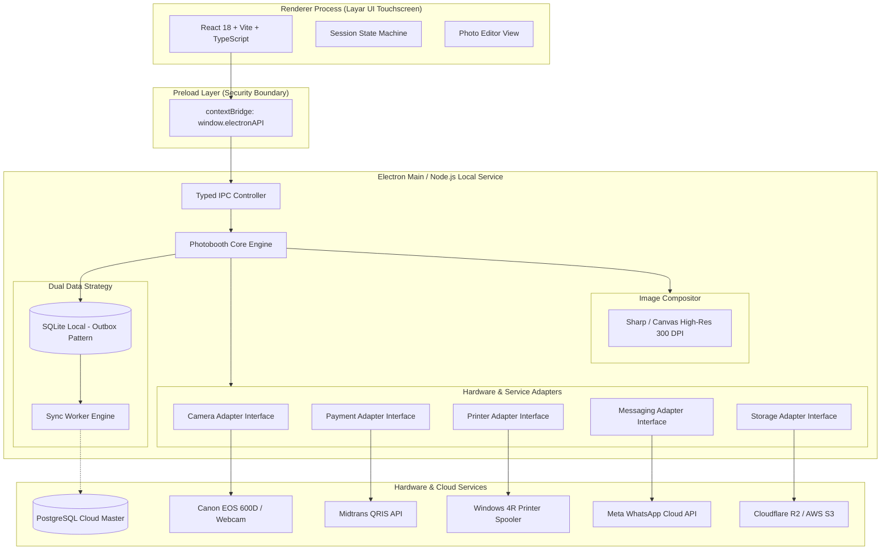
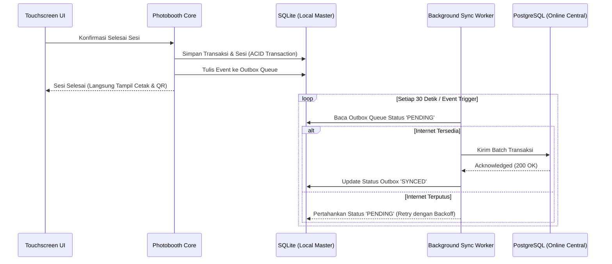

# MINJAPHOTOBOOTH — SOFTWARE ARCHITECTURE DOCUMENT

**Versi:** 1.0  
**Status:** Baseline Disetujui  
**Target Platform:** Windows 10/11 64-bit  
**Pola Arsitektur:** Hexagonal (Ports & Adapters) + Offline-First Dual Storage  

---

## 1. Ringkasan Eksekutif & Prinsip Desain

MinjaPhotobooth dirancang sebagai sistem photobooth mandiri (unattended self-service) berbasis desktop Windows. Aplikasi ini harus memiliki keandalan tinggi (high reliability), tahan terhadap gangguan jaringan (fault-tolerant offline-first), serta memiliki antarmuka sentuh (touchscreen) yang mulus tanpa hambatan I/O.

### Prinsip Utama:
1. **Separation of Concerns (Pemisahan Tanggung Jawab):** Frontend hanya bertanggung jawab atas penyajian visual dan interaksi pengguna. Semua kalkulasi harga, logika bisnis, dan interaksi perangkat fisik dijalankan di backend/main process.
2. **Adapter Pattern (Modularitas Perangkat Keras):** Seluruh integrasi eksternal (Kamera, Printer, Payment Gateway, WhatsApp) dienkapsulasi dalam adapter terpisah dengan antarmuka (interface) seragam.
3. **Zero Secrets in Frontend:** Server key, token API, dan algoritma verifikasi tidak boleh dikirimkan atau diproses pada proses renderer (layar UI).
4. **Offline-First Resilience:** Transaksi dan sesi tetap dapat beroperasi secara lokal menggunakan SQLite. Jika jaringan terputus, data diantrekan dan disinkronkan ke PostgreSQL online begitu koneksi pulih.
5. **Idempotent Operations:** Notifikasi pembayaran dan perintah pencetakan harus memiliki kunci idempoten untuk mencegah tagihan ganda atau cetak berulang tanpa izin.

---

## 2. Diagram Arsitektur Sistem



---

## 3. Komponen Arsitektur Utama

### 3.1 Renderer Process (Frontend UI)
- **Teknologi:** React, TypeScript, Vite, Vanilla CSS / Modern UI tokens.
- **Karakteristik Layar:** Orientasi Landscape, resolusi target 1920x1080 (Full HD) atau 4K, optimasi sentuhan (touch target minimum 48x48 px, feedback audio & visual instan).
- **Virtual Keyboard:** Keyboard on-screen mandiri untuk input data pelanggan (nomor WhatsApp) tanpa bergantung pada keyboard bawaan Windows yang sering menutup layar.
- **Tanpa Node.js Integration:** Renderer diisolasi sepenuhnya (`nodeIntegration: false`, `contextIsolation: true`) untuk mencegah eksekusi kode berbahaya dari konten dinamis.

### 3.2 Preload Layer (Batas Keamanan & Typed Bridge)
- Menggunakan `contextBridge.exposeInMainWorld('electronAPI', {...})`.
- Seluruh channel IPC didefinisikan secara deklaratif dengan tipe data TypeScript dua arah (request & response contracts).
- Tidak ada akses bebas ke fungsi Node.js (`fs`, `child_process`, `net`) dari jendela browser.

### 3.3 Backend Core Service (Electron Main Process)
- **Session Manager:** Mengatur siklus hidup sesi pelanggan dari mulai hingga reset.
- **Price Engine:** Menghitung total biaya secara absolut berdasarkan aturan paket di database lokal.
- **Image Compositor:**
  - Mengolah foto RAW/JPEG hasil jepretan kamera.
  - Melakukan koreksi orientasi, filter warna, dan penggabungan dengan template 4R.
  - Merender output 300 DPI (1200 x 1800 px) secara terpisah di background thread agar tidak membekukan antarmuka.

---

## 4. Arsitektur Data: Offline-First Dual Storage

Aplikasi menggunakan strategi penyimpanan ganda (dual-tier storage) untuk menjamin photobooth tetap beroperasi saat internet mall/venue mengalami gangguan:



### 4.1 SQLite (Local Master)
- **Tujuan:** Sumber data utama saat runtime lokal (Zero Latency, Full Offline Support).
- **Tabel Utama:**
  - `sessions`: Status sesi aktif, paket yang dipilih, timestamp.
  - `photos`: Metadata foto per sesi (path lokal, status terpilih).
  - `transactions`: ID pesanan, jumlah bayar, metode, status Midtrans.
  - `print_jobs`: Antrean cetak, jumlah salinan, status spooled/failed.
  - `admin_configs`: Hash PIN admin, pengaturan branding, parameter hardware.
  - `sync_outbox`: Antrean pesan untuk sinkronisasi ke cloud PostgreSQL.

### 4.2 PostgreSQL (Online Master)
- **Tujuan:** Dasbor pusat monitoring multi-booth, konsolidasi laporan keuangan, dan backup analitik.
- **Komunikasi:** Asinkron via worker pool dengan mekanisme rekonsiliasi otomatis saat koneksi aktif kembali.

---

## 5. Pola Desain Adapter (Hardware & External Services)

Untuk memenuhi aturan nomor 6 dan 7 ("Jangan membuat fungsi perangkat palsu" & "Gunakan adapter/service tersendiri"), setiap modul eksternal mengimplementasikan Interface kontrak formal:

### 5.1 Modul Kamera (`CameraAdapter`)
```typescript
interface ICameraAdapter {
  listDevices(): Promise<CameraDeviceInfo[]>;
  connect(deviceId: string): Promise<void>;
  disconnect(): Promise<void>;
  startLiveView(onFrame: (buffer: Buffer) => void): Promise<void>;
  stopLiveView(): Promise<void>;
  capture(settings: CaptureSettings): Promise<CapturedPhotoResult>;
  getStatus(): Promise<CameraStatus>;
}
```
- **Implementasi:**
  - `WebcamAdapter`: Berbasis WebRTC/DirectShow media API Windows.
  - `CanonDSLRAdapter`: Komunikasi native USB untuk Canon EOS 600D via EDSDK / gphoto2 CLI bridge terisolasi.
  - `MockCameraAdapter`: Digunakan khusus unit testing dan lingkungan pengembangan tanpa perangkat fisik.

### 5.2 Modul Pembayaran (`PaymentAdapter`)
```typescript
interface IPaymentAdapter {
  createQRIS(order: PaymentOrder): Promise<QRISPaymentResult>;
  checkStatus(orderId: string): Promise<PaymentStatusResult>;
  cancelPayment(orderId: string): Promise<void>;
}
```
- **Implementasi:**
  - `MidtransPaymentAdapter`: Integrasi Midtrans Snap QRIS API dengan SHA512 signature verification.
  - `MockPaymentAdapter`: Simulasi pembayaran instan/gagal untuk pengujian otomatis.

### 5.3 Modul Percetakan (`PrinterAdapter`)
```typescript
interface IPrinterAdapter {
  listPrinters(): Promise<PrinterDeviceInfo[]>;
  print4R(job: PrintJobRequest): Promise<PrintJobResult>;
  getJobStatus(jobId: string): Promise<PrintJobStatus>;
}
```
- **Implementasi:**
  - `WindowsSpoolerAdapter`: Berkomunikasi langsung dengan Windows Spooler API untuk kertas 4R borderless.
  - `MockPrinterAdapter`: Memverifikasi pembuatan file spool tanpa menggunakan kertas fisik.

### 5.4 Modul Pesan & Galeri Digital (`MessagingAdapter` & `StorageAdapter`)
```typescript
interface IMessagingAdapter {
  sendPhotoGallery(payload: WhatsAppDeliveryPayload): Promise<DeliveryResult>;
}

interface IStorageAdapter {
  uploadSoftFile(localPath: string, key: string): Promise<UploadResult>;
  generateSignedDownloadUrl(key: string, expiryMinutes: number): Promise<string>;
}
```
- **Implementasi:**
  - `WhatsAppCloudApiAdapter`: Integrasi resmi Meta Graph API WhatsApp Business.
  - `S3CloudStorageAdapter`: Mengunggah foto ke S3 / Cloudflare R2 dengan token download berbatas waktu.

---

## 6. Arsitektur Keamanan & Proteksi Data

1. **Autentikasi PIN Admin:**
   - PIN tidak disimpan dalam plaintext.
   - Menggunakan hashing **Argon2id** dengan salt dinamis unik untuk setiap mesin booth.
   - Proteksi brute force: Kunci akun otomatis selama 10 menit setelah 5 kali kesalahan beruntun.
2. **Pengamanan Token & Kredensial:**
   - Server keys (Midtrans, Meta API, DB Passwords) disimpan dalam file `.env` di direktori aman backend yang tidak dapat diakses dari browser renderer.
3. **Privasi Galeri Foto Pelanggan:**
   - Soft file foto hanya dapat diakses melalui URL unik yang memuat kriptografis nonce token (UUID v4 / Nanoid 32 karakter).
   - Kebijakan retensi otomatis: File dihapus dari penyimpanan cloud setelah waktu retensi tercapai (misal: 48 jam).

---

## 7. Roadmap Milestone Pengerjaan

| Milestone | Nama Tahapan | Cakupan Pekerjaan & Deliverables | Kriteria Pengujian (Verification Gate) |
|---|---|---|---|
| **M0** | **Baseline & Dokumentasi** | PRD, Arsitektur, API Contract, README, Git baseline | Review struktur dokumen lengkap & valid |
| **M1** | **Scaffolding Proyek** | Setup Electron + Vite + React + TS, SQLite local setup, Typed IPC bridge | `npm run build`, window terbuka, IPC ping-pong lolos |
| **M2** | **State Machine & Touch UI** | Alur sesi UI (Idle, Paket, Editor, Review), Virtual Numpad | Navigasi layar mulus tanpa error state |
| **M3** | **Modul Pembayaran QRIS** | Midtrans QRIS Adapter, Mock Payment, Webhook & Polling reconciler | Transaksi pending -> bayar -> sesi aktif secara idempotent |
| **M4** | **Pipeline Kamera** | CameraAdapter (Webcam, Canon EOS 600D, Mock), live preview, capture | Preview 30fps tampil, shutter menyimpan file RAW/JPEG |
| **M5** | **Editor & 4R Compositor** | Filter, template frame PNG, sticker, Sharp 300 DPI export | Output file 1200x1800 px sRGB presisi tanpa artefak |
| **M6** | **Pipeline Cetak 4R** | Windows Printer Spooler Adapter, print queue, status printer | Job masuk ke spooler Windows, test print valid |
| **M7** | **Distribusi Digital** | Cloud Storage Adapter, QR Galeri privat, WhatsApp Cloud API | QR dapat dipindai ponsel, WA pesan terkirim |
| **M8** | **Admin Panel & Security** | PIN Argon2id, CRUD paket/branding, Laporan audit, Ekspor CSV | Brute force terblokir, perubahan setting tersimpan |
| **M9** | **Hardening & Installer** | Windows installer (.exe), crash recovery, auto-updater | Installer berjalan bersih, data tidak hilang saat update |
