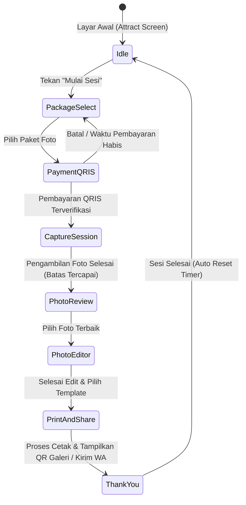

# MINJAPHOTOBOOTH — PRODUCT REQUIREMENTS DOCUMENT

**Versi:** 1.0  
**Platform:** Windows 10/11 64-bit  
**Jenis aplikasi:** Self-service photobooth desktop  
**Status:** Baseline Disetujui  
**Nama produk:** MinjaPhotobooth

---

## 1. Tujuan Produk

MinjaPhotobooth adalah aplikasi photobooth mandiri (self-service) yang dirancang khusus untuk lingkungan Windows. Aplikasi memungkinkan pelanggan untuk:
1. Memilih dan membeli paket sesi foto secara mandiri.
2. Membayar secara non-tunai melalui QRIS (Midtrans).
3. Mengambil foto dengan panduan live preview interaktif.
4. Memilih, menghapus, dan mengedit hasil foto (frame, filter, sticker, teks).
5. Mencetak foto fisik ukuran 4R (10x15 cm) berkualitas tinggi (300 DPI).
6. Mengunduh soft file foto beresolusi penuh melalui QR code galeri privat.
7. Menerima soft file langsung ke smartphone melalui WhatsApp Cloud API resmi.

Aplikasi beroperasi secara otomatis tanpa memerlukan operator mendampingi pelanggan sepanjang sesi. Untuk kebutuhan operasional, tersedia **Admin Panel tersembunyi** yang diamankan dengan autentikasi PIN untuk konfigurasi perangkat, tarif, template, branding, dan audit transaksi.

---

## 2. Target Pengguna

### Pelanggan (Self-Service)
- Berinteraksi langsung melalui layar sentuh (touchscreen) landscape.
- Pengalaman pengguna harus intuitif, cepat, tidak membingungkan, dan minim teks panjang.
- Memiliki kontrol penuh atas foto yang diambil (retake, pilih foto terbaik).
- Menerima hasil fisik (cetak) dan digital (QR/WhatsApp) secara instan.

### Pengelola / Admin
- Membuka panel kontrol melalui gestur/area tersembunyi dengan verifikasi PIN aman.
- Mengatur konfigurasi display: tema, logo, wallpaper, warna, dan teks selamat datang.
- Mengelola paket sesi: durasi waktu, batas pengambilan foto, batas foto cetak, dan harga.
- Memantau dan mengonfigurasi perangkat keras: kamera (webcam/DSLR), printer 4R, dan kertas.
- Mengakses laporan transaksi pendapatan, status pembayaran, dan riwayat cetak dengan fitur ekspor CSV.
- Mengatur kebijakan masa retensi penyimpanan soft file foto pelanggan.

---

## 3. Alur Pelanggan (Customer Journey)

1. **Layar Awal (Idle / Attract Screen):** Video/animasi menarik dengan tombol sentuh besar "Mulai Sesi".
2. **Pilih Paket:** Pelanggan memilih jenis sesi, jumlah cetak bawaan, dan fitur yang diinginkan.
3. **Pembayaran QRIS:** Sistem memanggil Midtrans Snap untuk menghasilkan QRIS dinamis di layar.
4. **Verifikasi Pembayaran:** Backend memvalidasi status transaksi secara real-time via webhook & polling.
5. **Sesi Foto (Countdown & Shutter):** Live preview kamera aktif, timer hitung mundur (3.. 2.. 1..), shutter capture, dan audio panduan suara.
6. **Review & Seleksi:** Pelanggan melihat galeri thumbnail sesi dan memilih foto yang akan dimasukkan ke template.
7. **Editor Foto:** Fitur crop, rotasi, filter warna, penambahan frame/template, sticker, dan preview layout cetak.
8. **Finalisasi & Cetak:** Rendering layout resolusi tinggi 4R (1200x1800 px pada 300 DPI), pengiriman job ke antrean printer Windows.
9. **Distribusi Digital:** Tampilan QR Code galeri privat berbatas waktu (misal: 48 jam) dan opsi input nomor WhatsApp untuk pengiriman otomatis via WhatsApp Cloud API.
10. **Pembersihan & Reset:** Sesi ditutup, file sementara dibersihkan dari memori, dan layar kembali ke status Idle.

---

## 4. Persyaratan Fungsional Detail

### 4.1 Kamera & Imaging
- **Dukungan Perangkat:**
  - Webcam USB standar (UVC).
  - Virtual Webcam (OBS Virtual Camera, vMix, dll).
  - DSLR/Mirrorless melalui adapter modular (Target awal: **Canon EOS 600D**).
- **Fitur Live Preview:**
  - Tampilan live stream halus (minimum 24–30 FPS).
  - Countdown visual interaktif dengan suara bip/shutter.
  - Multi-camera readiness melalui antarmuka `CameraAdapter`.
  - Penanganan status disconnect / reconnection tanpa crash aplikasi.

### 4.2 Editor Foto & Rendering
- **Manipulasi Gambar:** Crop proporsional, rotate 90°, mirror, pengaturan brightness & contrast.
- **Filter Kreatif:** Black & White, Vintage/Sepia, Warm, Cool, Glamour soft.
- **Komposisi:** Penambahan frame template PNG transparan, sticker, dan teks khusus (tanggal, watermark acara).
- **High-Resolution Renderer:**
  - Rendering independen dari resolusi layar monitor.
  - Standar ukuran cetak 4R: rasio 2:3 (1200 x 1800 px atau 1800 x 1200 px pada 300 DPI).
  - Format output: JPEG/PNG lossless sRGB untuk printer dye-sublimation / inkjet.

### 4.3 Paket & Perhitungan Biaya
- Seluruh validasi harga, diskon, dan biaya tambahan dihitung secara ketat di Backend.
- Struktur paket mencakup: ID paket, Nama, Harga dasar, Durasi sesi (detik), Maksimal capture, Maksimal foto terpilih, Jumlah cetak default.
- Opsi biaya tambahan (add-on): Tambahan lembar cetak fisik (+Rp per lembar).

### 4.4 Sistem Pembayaran (Midtrans QRIS)
- Integrasi Midtrans Snap API dengan metode pembayaran eksklusif QRIS.
- Siklus hidup transaksi: `pending`, `settlement`, `expire`, `cancel`, `deny`.
- **Idempotency:** Webhook notifikasi diproses satu kali saja menggunakan ID transaksi unik untuk mencegah duplikasi sesi.
- **Polling Reconciler:** Jika koneksi webhook terhambat, aplikasi melakukan pengecekan berkala ke Midtrans API sebelum menyatakan pembayaran gagal/kadaluwarsa.
- **Proteksi:** Sesi kamera dilarang keras aktif sebelum pembayaran status `settlement` tervalidasi.

### 4.5 Pencetakan (Printing 4R)
- Integrasi Windows Print Spooler melalui adapter driver printer (DNP, Citizen, HiTi, Epson, Canon, dll).
- Validasi status printer (Ready, Paper Out, Ribbon Out, Offline) jika didukung oleh driver.
- Fitur Test Print dari Admin Panel untuk kalibrasi warna dan margin borderless.
- Manajemen antrean cetak lokal untuk menjamin order tidak hilang jika terjadi paper jam.
- Fasilitas Reprint khusus Admin dengan pencatatan alasan pada audit log.

### 4.6 Galeri Privat & WhatsApp Cloud API
- **QR Galeri:**
  - Mengarahkan pelanggan ke halaman web galeri privat berenkripsi token.
  - Token acak berkekuatan tinggi (UUID v4 / nanoid kriptografis), bukan ID sekuensial.
  - Masa aktif (retensi) dapat diatur oleh Admin (default: 48 jam).
- **WhatsApp Cloud API:**
  - Menggunakan API resmi Meta WhatsApp Business Platform.
  - Pengiriman pesan berbasis template terverifikasi yang melampirkan tautan galeri atau media foto.
  - Antrean pengiriman asinkron (background queue) dengan mekanisme retry otomatis jika jaringan lokal sempat terputus.

### 4.7 Admin Panel Tersembunyi
- Akses via kombinasi sentuhan tersembunyi (misal: tap logo 5x berturut-turut).
- Autentikasi PIN dengan hashing aman (Argon2id/bcrypt), proteksi brute force (lockout setelah 5x gagal).
- Konfigurasi branding: Upload logo, nama booth, wallpaper attract screen, palet warna primer/sekunder.
- Manajemen paket harga, daftar kamera aktif, dan default printer.
- Dasbor analitik: Total pendapatan, sesi selesai, transaksi gagal, dan cetak gagal.
- Ekspor laporan penjualan dalam format file CSV.

---

## 5. Persyaratan Non-Fungsional

1. **Keamanan (Security First):**
   - Kredensial rahasia (Midtrans Server Key, WhatsApp Token, Database Password, Hash Salt) hanya boleh berada di backend via Environment Variables (`.env`).
   - Tidak ada hardcoded credentials atau default PIN yang mudah ditebak.
   - Frontend tidak boleh mengakses langsung sistem berkas (file system) atau shell tanpa melalui kontrak IPC yang terkontrol ketat.
2. **Kinerja & Responsivitas:**
   - Antarmuka sentuh responsif tanpa jeda input (latensi sentuh < 50ms).
   - Rendering grafis dan komunikasi hardware tidak boleh memblokir (freeze) UI thread (menggunakan worker process / asynchronous I/O).
3. **Ketahanan Offline (Offline Resiliency):**
   - Basis data lokal SQLite menangani seluruh status sesi, konfigurasi mesin, dan antrean cetak saat koneksi internet terputus.
   - Sinkronisasi data ke PostgreSQL online berjalan otomatis di latar belakang saat koneksi pulih.
4. **Pemeliharaan & Pembaruan:**
   - Sistem auto-updater yang memperbarui aplikasi tanpa menghapus basis data lokal, konfigurasi, atau arsip foto.

---

## 6. Batasan Rilis Versi 1.0

- 1 mesin komputer berbasis Windows 10/11 64-bit.
- 1 target kamera DSLR utama: **Canon EOS 600D** (didukung webcam USB & virtual webcam sebagai alternatif).
- 1 printer foto 4R utama yang terkonfigurasi pada Windows Spooler.
- 1 payment gateway: Midtrans QRIS.
- Penyimpanan lokal + cloud hosting privat untuk web galeri.

---

## 7. Kriteria Selesai (Definition of Done)

Aplikasi MinjaPhotobooth dinyatakan selesai dan siap diproduksi apabila:
- [ ] Seluruh dokumen arsitektur dan API contract disetujui.
- [ ] Build installer Windows (`.exe` / `.msi`) berhasil dibuat secara otomatis.
- [ ] Transaksi pembayaran QRIS sandbox & production terverifikasi secara idempotent.
- [ ] Kamera Canon EOS 600D dan webcam USB dapat melakukan live preview dan shutter capture stabil.
- [ ] Rendering 4R menghasilkan gambar 300 DPI tajam tanpa artefak visual.
- [ ] Hasil cetak fisik 4R presisi sesuai template dan warna sRGB.
- [ ] QR code galeri privat dapat dipindai dan dibuka secara instan dari smartphone pelanggan.
- [ ] Soft file berhasil terkirim melalui WhatsApp Cloud API ke nomor pelanggan yang valid.
- [ ] Admin panel terlindungi PIN dengan fitur konfigurasi paket dan ekspor CSV yang berfungsi 100%.
- [ ] Database lokal SQLite menyimpan data secara konsisten dan pulih normal saat aplikasi direstart mendadak.
